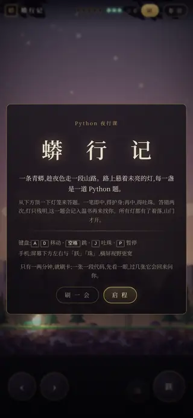
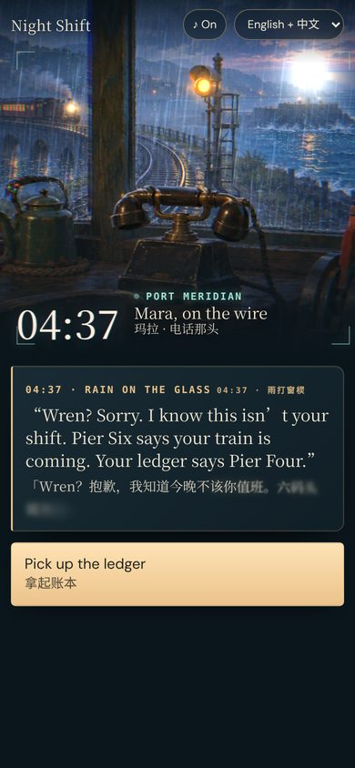

### I build systems where a model's claim is never the evidence.

**Results before theory.** Time-to-demo is 90 seconds: if it runs, you can see it.

<table>
<tr>
<td valign="top"> <a href="https://lyrapower.github.io/voice-garden/"><b>▶ Voice Garden</b></a>: particles that move with your voice or music</td>
<td valign="top"> <a href="https://lyrapower.github.io/bodymap/"><b>▶ RELAE</b></a>: tap where it hurts</td>
</tr>
</table>

**New: three more, playable in the browser** ([all works](https://lyrapower.github.io/Lyrapower/))

<table>
<tr>
<td valign="top" width="33%"> <a href="https://lyrapower.github.io/Lyrapower/mangxingji/"><b>▶ 蟒行记 MangXingJi</b></a>: the most addictive way to learn Python in five spare minutes. 327 code cards, every answer checked by running real Python</td>
<td valign="top" width="33%"> <a href="https://lyrapower.github.io/Lyrapower/earth-online-guide/"><b>▶ 地球Online · 玩家指南</b></a>: seven Chinese classics in full, Chinese and English, illustrated and narrated</td>
<td valign="top" width="33%"> <a href="https://lyrapower.github.io/Lyrapower/night-shift/"><b>▶ Night Shift · 港城夜班</b></a>: a bilingual night shift at a port signal box. Decide without knowing; no score</td>
</tr>
</table>

| Project | What it is |
| --- | --- |
| [RELAE](https://github.com/Lyrapower/bodymap) | Open source. Tap where it hurts on a 3D human body (Z-Anatomy: skin, muscle, bone) and keep a record a doctor can read. Records stay on your device. [Live demo](https://lyrapower.github.io/bodymap/) |
| [voice-garden](https://github.com/Lyrapower/voice-garden) | Open source. A 100,000-particle Three.js spiral that turns and glows with your voice or music, in the browser. [Live demo](https://lyrapower.github.io/voice-garden/) |
| [蟒行记 MangXingJi](https://github.com/Lyrapower/Lyrapower/tree/main/works/mangxingji) | Open source. Learn Python in five-minute sessions: a swipe-style card reel with spaced repetition and a pixel platformer. Works offline after one visit. [Play](https://lyrapower.github.io/Lyrapower/mangxingji/) |
| [地球Online · 玩家指南](https://github.com/Lyrapower/Lyrapower/tree/main/works/earth-online-guide) | Open source. Tao Te Ching, Art of War, Shan Hai Jing, Huangdi Neijing, Zhuangzi, I Ching, Shiji: collated originals, Legge/Giles English, narration, ask-this-book. [Open](https://lyrapower.github.io/Lyrapower/earth-online-guide/) |
| [Night Shift · 港城夜班](https://github.com/Lyrapower/Lyrapower/tree/main/works/night-shift) | Open source. Bilingual interactive fiction where the world keeps moving and the truth stays hidden. [Play](https://lyrapower.github.io/Lyrapower/night-shift/) |
| [voice-garden-render](https://github.com/Lyrapower/voice-garden-render) | Open source. One command turns any song into a particle music video (MP4), frame-exact and offline. |
| [quant-research-showcase](https://github.com/Lyrapower/quant-research-showcase) | Paper-only factor research: lineage, IC gates, point-in-time data, shadow-ledger settlement. |
| [rwa-onchain-reader-showcase](https://github.com/Lyrapower/rwa-onchain-reader-showcase) | Tokenized-treasury supply, published only when two RPC witnesses agree bit-for-bit on the same block. |
| [bounty-agent-showcase](https://github.com/Lyrapower/bounty-agent-showcase) | An agent that submits only where the repo's written policy allows AI, and always says so. |

**A hypothesis I'm testing.** In my setting, standard RAG distorts meaning across two hops. I key memory with protocol-level content hashes, so recall never depends on embedding-model compatibility.

**Verification by default.** Local private key, signature, traceable record. Anyone doing compliance needs that same chain.

**What's not public yet.** Happy to go deeper on tuning and codec details. I also have a more aggressive causal-patch approach that I haven't published.
