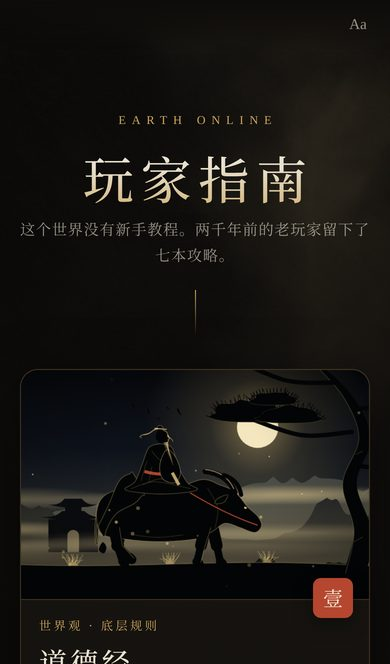
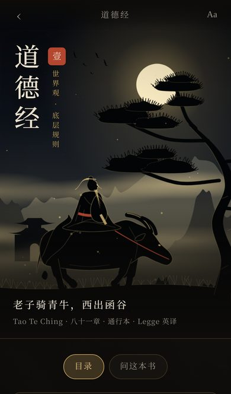
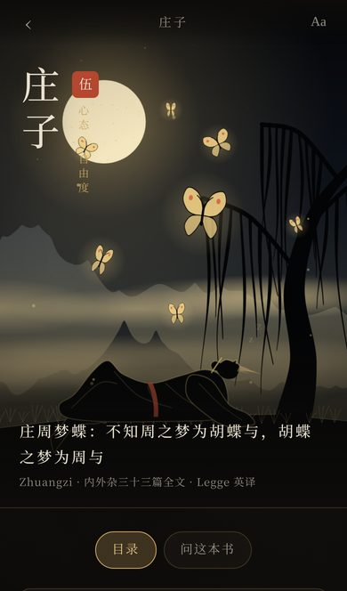
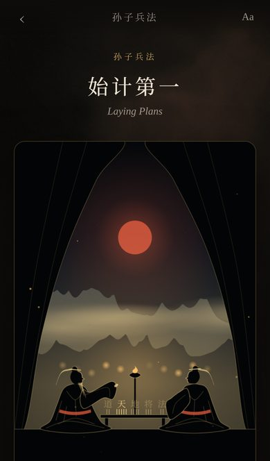
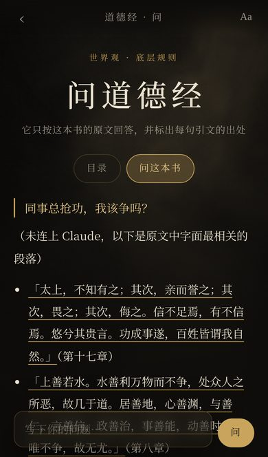

# 地球Online · 玩家指南

**这个世界没有新手教程。两千年前的老玩家留下了七本攻略。**

**[▶ 在线打开](https://lyrapower.github.io/Lyrapower/earth-online-guide/)** · 手机上最好看 · 不用注册，阅读进度只存在你自己的设备上

<p align="center"><a href="https://lyrapower.github.io/Lyrapower/earth-online-guide/"></a></p>

你有没有想过：

- 「上善若水」后面那半句是什么？Legge 1891 年怎么把它译成英文？
- 同事总抢功，《道德经》会怎么说？哪一章、原话是哪一句？
- 睡前想听一章《孙子兵法》，配着雨声，30 分钟后自己停？

**直接试** · [道德经 · 上善若水](https://lyrapower.github.io/Lyrapower/earth-online-guide/#/b/ddj/8) · [庄子 · 庄周梦蝶](https://lyrapower.github.io/Lyrapower/earth-online-guide/#/b/zz/2) · [孙子 · 知彼知己](https://lyrapower.github.io/Lyrapower/earth-online-guide/#/b/sunzi/3) · [史记 · 货殖列传](https://lyrapower.github.io/Lyrapower/earth-online-guide/#/b/sj/1) · [周易 · 乾卦](https://lyrapower.github.io/Lyrapower/earth-online-guide/#/b/yi/1) · [山海经 · 招摇之山](https://lyrapower.github.io/Lyrapower/earth-online-guide/#/b/shj/1)

<p align="center">




</p>

七本书的原文（史记选七篇，每篇全文），能中英对照，有插画和动画，有朗读，能按书提问：

| 区 | 书 | 内容 | 英文 |
| --- | --- | --- | --- |
| 壹 · 世界观 | 道德经 | 八十一章，通行本 | James Legge 译，1891 |
| 贰 · 策略手册 | 孙子兵法 | 十三篇，四库本为底本逐字校对 | Lionel Giles 译，1910 |
| 叁 · 地图 | 山海经 | 十八卷全文 | 只有原文 |
| 肆 · 角色属性 | 黄帝内经 | 素问、灵枢 162 篇全文 | 只有原文 |
| 伍 · 自由度 | 庄子 | 内外杂三十三篇全文 | James Legge 译，1891 |
| 陆 · 状态机 | 周易 | 六十四卦经文 + 彖、象、文言、系辞、说卦、序卦、杂卦 | 只有原文 |
| 柒 · 前人的对局 | 史记 | 选七篇，每篇全文（货殖列传、留侯世家、淮阴侯列传、项羽本纪……） | 只有原文 |

- **原文不删不改**：以学术电子本（四部丛刊 / 四库全书的逐字录入）为底本，标点取通行标点本，逐章逐字对齐校勘。校勘脚本在 `data-pipeline/`。
- **朗读**：《道德经》中文、英文全本，《孙子兵法》英文全本，提前合成好的音频（中文 39 分钟、英文 75 分钟 + 77 分钟），可以配雨声、溪水、风声，定时关闭，适合睡前听。其他几本用设备自带的朗读声音。
- **按书提问**：问一个处境，比如「同事总抢功，我该争吗？」，它从这本书里找出最相关的原文段落，每句引文都在原文里核过，点一下就跳到出处。在 Claude 里打开时，Claude 会只按这本书的原文作答，没有英译的几本也能现译。
- 夜墨 / 宣纸两种纸色，字号可调，记住读到哪里，减少动效的设置会被尊重。

<p align="center"></p>

## 文本数据可以直接拿去用

七部书逐字校勘过的原文（约 40 万字，含 Legge、Giles 英译），整理成了 JSON，放在 [`data/`](data/)，以 CC0 发布。拿去做阅读器、检索、语料、出题都行。

## 自己运行

整个应用是一个 HTML 文件，加一个放朗读音频的 `audio/` 文件夹。

```
git clone https://github.com/Lyrapower/Lyrapower && cd Lyrapower/works/earth-online-guide
python3 -m http.server 8000      # 然后打开 http://localhost:8000
```

直接双击 `index.html` 也能读，但浏览器会拦下本地音频，所以朗读要用上面的方式开。

## English

**Earth Online: A Player's Guide** is a reading app for seven Chinese classics: Tao Te Ching, The Art of War, Shan Hai Jing, Huangdi Neijing, Zhuangzi, I Ching and selected chapters of the Shiji. Full original texts, collated character by character; side-by-side English from the public-domain translations of James Legge and Lionel Giles; illustrated and animated chapter plates; pre-recorded narration of the Tao Te Ching (Chinese and English) and The Art of War (English) with optional rain, stream or wind in the background; and an "ask this book" mode that pulls the most relevant passages for a question and checks every quotation against the text (opened inside Claude, it answers from the book and can translate the untranslated ones). One HTML file, no account, reading progress stays on your device.

## Sources and licenses

See [NOTICE.md](NOTICE.md). In short: the classical Chinese texts and the Legge and Giles translations are in the public domain; the narration was synthesized with the open-source Kokoro-82M voice model; the app code is MIT.

This is a reading app, not medical advice. 黄帝内经的内容是古籍原文，不是医疗建议。

和 Claude 一起做的 / made with Claude.
