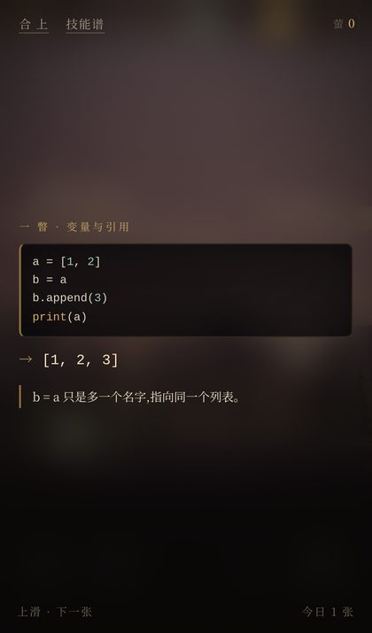
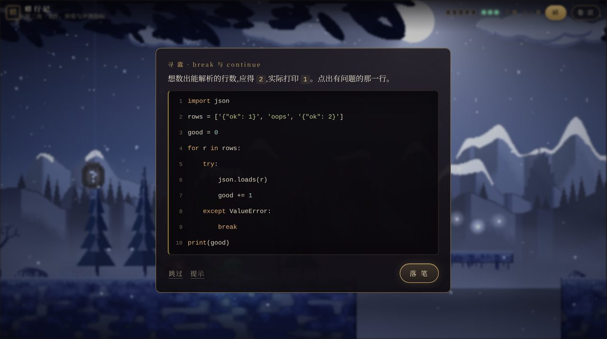

# 蟒行记 · 最上瘾的 Python 学习游戏

**每天五分钟、十分钟。等车、候机、在飞机上、睡前躺着，随手刷几张卡、闯一段关，Python 就不经意地进了脑子。**

**[▶ 在线玩](https://lyrapower.github.io/Lyrapower/mangxingji/)** · 手机、电脑都能玩 · 打开一次之后，断网也能玩（飞机上照样刷）· 手机上可以「添加到主屏幕」，像 App 一样打开 · 不用注册，进度存在你自己的设备上

<p align="center"><a href="https://lyrapower.github.io/Lyrapower/mangxingji/"></a></p>

```
git clone https://github.com/Lyrapower/Lyrapower && cd Lyrapower/works/mangxingji
python3 build.py .
open dist/index.html        # Windows: start dist\index.html
```

## 为什么学得进去

传统的学法是打开教程、从第一章读起，读到第三章就困了。蟒行记反过来：不让你坐下来"学"，而是让你停不下来。

- **像刷短视频一样刷代码**：点右上角的「刷」，一屏一张代码卡片，猜它会输出什么，上滑下一张。一张卡几秒钟，等一趟车就能刷上一串。
- **答对有手感**：连击计数、萤火、偶尔出现的金卡，每天来刷还有连日记录。
- **忘了它会回来**：卡片按遗忘曲线排期。答对的隔几天再见，答错的过几张就再出现，记不住的那几张会一直回来，直到你记住。
- **想玩久一点就闯关**：你是一条在夜里赶路的小蟒蛇。每盏灯笼里是一道题：读代码、猜输出、点出有 bug 的那一行。答对灯就亮，走到天亮，这一夜的知识点就过了一遍。

| 刷卡（手机） | 关卡里的题 |
| --- | --- |
|  |  |

## 30 天路线：每天 5 分钟，大约 11 张卡

新卡大致按下面的顺序出现，旧卡按遗忘曲线穿插回来。不用记进度，打开就刷。

| 时间 | 刷到的主题 | 卡数 | 想玩久一点 |
| --- | --- | ---: | --- |
| 第 1 周 | 变量与引用 · 数字与运算 · 字符串 · 列表 · 切片 · 字典 | 109 | 第一夜：引用、不可变与文本清洗 |
| 第 2 周 | 集合与元组 · 条件与真值 · 循环 · 推导式与生成器 · 函数 | 82 | 第二夜：容器、查找复杂度与集合运算 |
| 第 3 周 | 类与对象 · 异常 · 文件、JSON 与路径 · 标准库 | 78 | 第三夜：文件、异常与评测指标；第四夜：正则表达式 |
| 第 4 周 | 迭代器、装饰器、上下文 · 类型标注与异步 · NumPy · pandas | 58 | 第五夜：脚本工程化；第六夜：红队评测与攻击成功率 |
| 第 30 天 | 327 张全见过一遍，记不牢的那些还会回来 | 327 | 六夜通关 |

## 里面有什么

- **6 夜关卡、30 道关卡题**：引用与不可变 · 容器与集合运算 · 文件、异常与评测指标 · 正则表达式 · 脚本工程化（参数、日志、计时）· 红队评测与攻击成功率
- **327 张代码卡片，19 个主题**：变量与引用、数字、字符串、列表、切片、字典、集合与元组、真值、循环、推导式与生成器、函数、类、异常、文件与 JSON、标准库、迭代器 / 装饰器 / 上下文、类型标注与异步、NumPy、pandas
- 题型：猜输出、判断对错、点出出错的那一行、填空
- 6 套夜景主题、程序生成的配乐；WebGL 光照，老设备自动退回 2D（地址后加 `#nogl` 可以强制 2D）

**每张卡片的答案都由真的 Python 跑出来核对过。** `test/check_cards.py` 会执行全部 327 段代码，比对卡片上写的答案，现在 327/327 全对。

## 操作

电脑：<kbd>A</kbd> <kbd>D</kbd> 或方向键移动 · <kbd>空格</kbd> 跳（按得久跳得高）· <kbd>J</kbd> 吐珠 · <kbd>P</kbd> 暂停。手机上有触屏按键。

## 开发

源文件在 `src/`，`python3 build.py .` 把它们合成 `dist/index.html`，没有其他依赖。

```
pip install numpy pandas && python3 test/check_cards.py     # 327 张卡片逐张执行
npm i playwright && npx playwright install chromium
HASH='#nogl' node test/e2e.js       # 关卡玩法 58 项
HASH='#nogl' node test/e2e_reel.js  # 刷卡 29 项
node test/e2e_v3.cjs                # WebGL 呈现层 20 项
node test/offline.cjs               # 断网后重开照样能玩
```

卡片的写法见 `src/cards.txt`：`%%` 分隔，`=` 后是答案，`?` 后是干扰项，`!` 后是一句讲解。欢迎提 PR 补卡片，或者报告答案不对的卡片。

## English

**MangXingJi** is built to be the most addictive way to learn Python in five spare minutes: on the bus, at the airport, on a plane (it works offline after one visit). It is a pixel-art night-walk platformer, written in Chinese. Each lantern holds a question (predict the output, spot the buggy line, fill the blank), and a swipe-style card reel with spaced repetition covers 327 snippets across 19 topics, from references and slicing to NumPy and pandas. Every card's answer is checked by executing it with real Python (`test/check_cards.py`). One HTML file, works offline, no account.

## License

MIT · 和 Claude 一起做的 / made with Claude
