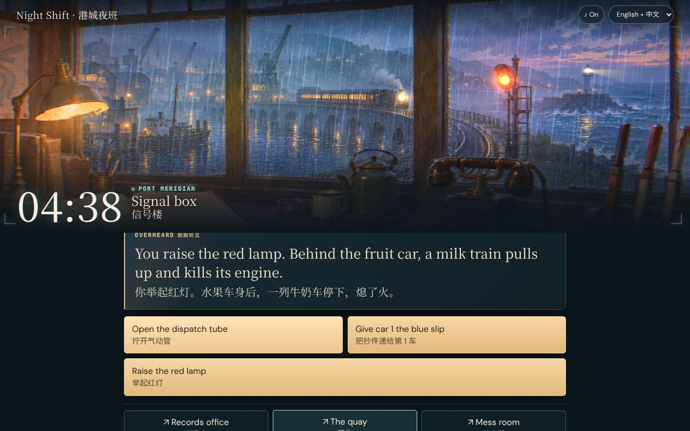
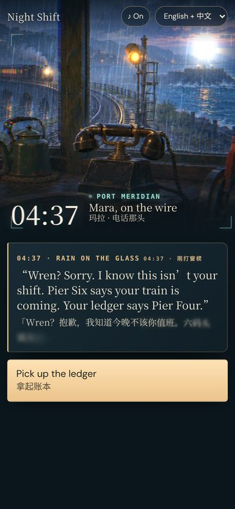
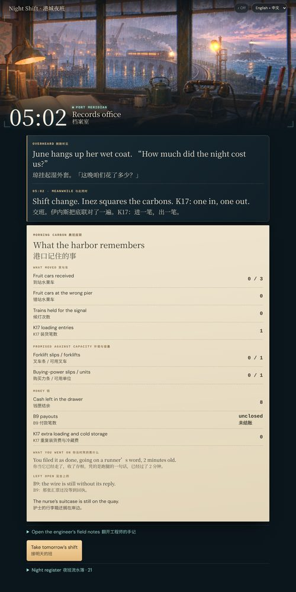

# Night Shift · 港城夜班

**A short bilingual night shift at a rainy port signal box. Nothing is ever fully known; you decide anyway, and the morning carbon shows what you went on.**
**雨夜港口信号楼里的一个夜班，中英双语。事情从来看不全，你照样得拍板；天亮时的底联会写下你凭的是什么。**

**Download and open `dist/index.html` · 下载后打开 `dist/index.html`** · phone or desktop · one HTML file, no account

<p align="center"></p>

It is 04:37 at Port Meridian. Rain on the glass, the phone has been ringing for a while, and a crate called K17 may or may not still be on the scale. Trains come through on their own schedule, the crane works through its queue whether you watch or not, and on fog nights neither the scale nor the weighbook can tell you the truth.

现在是港城凌晨 4 点 37 分。雨打在玻璃上，电话响了好一阵，K17 那只货箱可能还在秤台上，也可能早走了。火车照自己的点过，吊车照自己的队列干活，你看不看它都在动；雾夜里秤台和秤簿都给不出答案。

- **A world that moves without you**: every loading order that reaches the crane gets executed; if nobody answers Inez by 04:57, she sends the order again herself.
- **Imperfect moves, real costs**: chalk HOLD on the hook, ask for the five o'clock count (it costs a held wagon), or pay a runner two coins for a look that is already a minute old.
- **No score**: the morning carbon groups what moved, what was promised against capacity, money, what you went on, and what was left open. There is no total.
- **Language**: English + 中文 side by side, English only, or 中文 only. Text appears word by word; tap to show it all.
- An oil-painted scene with rain, light and parallax, and sound synthesized live in the browser (no audio files). Falls back to a still painting without WebGL, and holds still if you ask your system for reduced motion.

| | |
| --- | --- |
|  |  |

## Run it

```
git clone https://github.com/Lyrapower/Lyrapower && cd Lyrapower/works/night-shift
open dist/index.html            # Windows: start dist\index.html
```

## Tests

```
node verify.cjs                 # the original rules harness, 64 shifts replayed (silent + exit 0 = pass)
node verify_v4.cjs              # K17 outcome table, 1024 seeds, conservation and determinism, fuzzing
npm i playwright && npx playwright install chromium && node test/e2e.cjs   # 50 browser checks
```

## License

MIT · made with Claude
